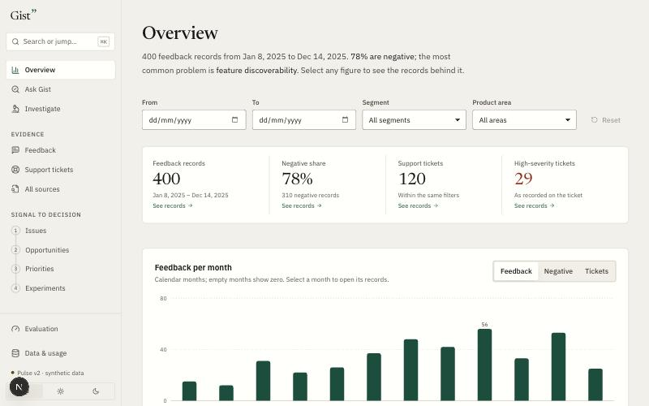
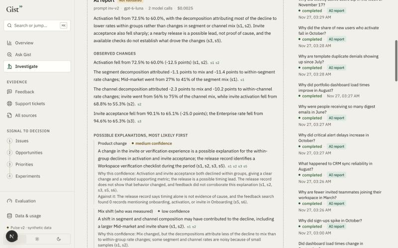
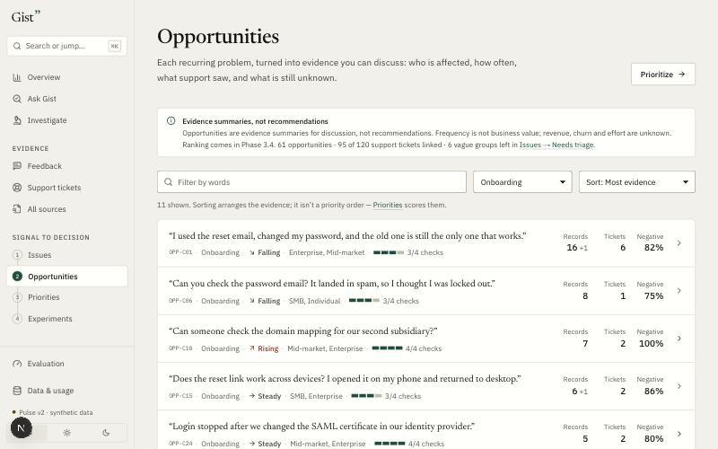
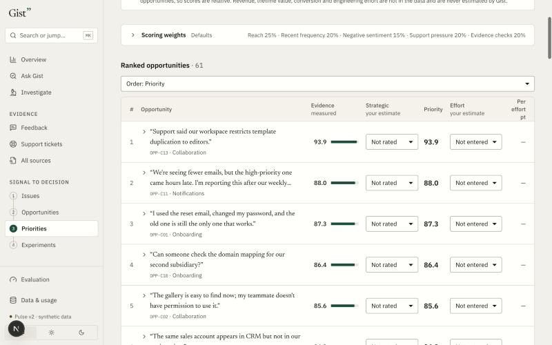
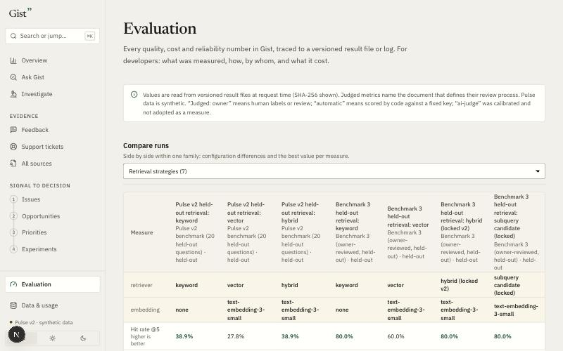
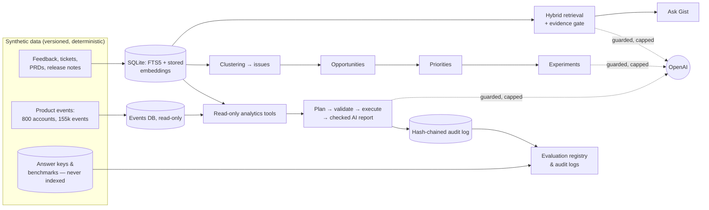

# Gist

**An AI product-intelligence copilot that shows its work.** · [Live demo](https://gist-tau.vercel.app) Gist turns customer feedback, support tickets, product documents and usage data into product decisions you can trace: recurring problems, evidence-backed opportunities, a transparent priority score, experiment ideas, and root-cause investigations. Every claim links back to the records behind it.

> **All data is synthetic.** "Pulse" is a fictional SaaS product. Gist is a portfolio project built to learn retrieval-augmented generation (RAG) and evaluation properly, not a commercial product.



## What it does

| | |
|---|---|
| **Ask Gist** | Ask a question in plain language. Free mode ranks the relevant sources (hybrid keyword + vector retrieval); paid mode writes a cited answer and declines when the evidence is thin. |
| **Issues → Opportunities** | Clusters 400 feedback records into 67 recurring sub-themes, then turns each into an opportunity card: who is affected, how often, linked support tickets, related documents, assumptions and unknowns. |
| **Priorities** | A transparent, editable score. Measured parts come from the data; strategic relevance and effort are *your* estimates, labelled as such. Revenue and effort are never made up. |
| **Experiments** | One AI-drafted experiment per opportunity (hypothesis, metric, guardrails, design), checked automatically and clearly marked "not validated". |
| **Investigate** | "Why did activation drop in October?" A bounded plan → read-only analytics tools → findings, and optionally an AI root-cause report that must cite every step and never claim certainty. |
| **Evaluation** | Every quality, cost and reliability number, traced to a versioned result file, with who judged it and what it cost. |

<table><tr>
<td></td>
<td></td>
</tr><tr>
<td></td>
<td></td>
</tr></table>

Walk through it yourself with the [five demo scenarios](docs/demo-scenarios.md).

## Architecture



- **Frontend:** Next.js 15 (App Router), TypeScript, Tailwind. It renders only numbers the API returns.
- **Backend:** FastAPI, Pydantic, SQLite (FTS5), NumPy. No LangChain, no vector database, no Docker: the whole corpus fits in SQLite, and every step stays inspectable.
- **AI:** OpenAI `text-embedding-3-small` and `gpt-6-luna`, called only through one guarded provider with a spend ledger, output caps and per-call cost recording.

More: [architecture notes](docs/architecture.md) · [decisions log](docs/decisions.md) · [developer guide](docs/developer-guide.md).

## Results (measured against targets set in advance)

Gist was built one milestone at a time. Each milestone had acceptance targets written **before** any run, set deliberately high, and frozen held-out tests ran **exactly once**. A result that fell short is shown as **below target · accepted limitation**: recorded with its cause, accepted by the project owner, and never fixed by re-tuning against the test. Full detail, with file hashes, is on the in-app **Evaluation** page.

| Area | Measure (held-out unless noted) | Result | Target | Status |
|---|---|---|---|---|
| Security | Prompt injection, unsafe SQL, citation fabrication, key leaks, runaway loops | 25 tests pass | all pass | **PASS ✅** |
| Answers | Unanswerable questions correctly declined (Benchmarks 4 and 5) | 4 of 4, both benchmarks | 100% | **PASS ✅** |
| Linking | Support-ticket link precision / top document correct | 0.88 / 1.00 | ≥ 0.80 / ≥ 0.75 | **PASS ✅** |
| Prioritization | Top-10 overlap when any weight moves ±50% | 9.6 of 10 | ≥ 7 | **PASS ✅** |
| Clustering | Purity / issue recall / look-alike issues separated (test half) | 0.91 / 0.82 / 7 of 7 | ≥ 0.85 / ≥ 0.75 / ≥ 6 | **PASS ✅** |
| Clustering | Number of themes; vague records left ungrouped | 64 themes; 0% | ≤ 24; ≥ 50% | Below target · accepted limitation |
| Investigations | Planted root causes found | 4 of 6 | ≥ 4 | **PASS ✅** |
| Investigations | Decoys (mix shift, tracking gap, holiday, untracked metric): correct top explanation | 3 of 4 | ≥ 3 | **PASS ✅** |
| Investigations | Decoys: never blamed a product change with high confidence | 3 of 4 (one report timed out) | 4 of 4 | Below target · accepted limitation |
| Answers | Owner-rated "good": Benchmark 4 / Benchmark 5 (of 20 answerable) | 8 / 9 | ≥ 10 | Below target · accepted limitation |
| Experiments | Owner review of 10 AI drafts: useful / sensible metric / wrong | 5 / 7 / 0 | ≥ 6 / ≥ 8 / ≤ 1 | Below target · accepted limitation (wrong ≤ 1: PASS ✅) |
| Retrieval | Hit rate @5: first v2 benchmark (hybrid, 18 answerable) | 38.9% | judged, no number | Below release bar · baseline |
| Retrieval | Hit rate @5: Benchmark 4 / Benchmark 5 (20 answerable each) | 95.0% / 75.0% | none set | Measured |

Different benchmarks use different question sets, so their numbers are not directly comparable. What fell short, and why, is in the [case study](docs/case-study.md).

**Total AI spend for the whole project: about $0.14** (537 requests; OpenAI billing for the busiest day matched the ledger within 3.1%).

## Run it locally ($0, no API key)

Requires Python 3.11+ and Node.js 20+.

```sh
python3 -m venv .venv && .venv/bin/pip install -r backend/requirements-dev.txt
(cd frontend && npm install)
.venv/bin/python backend/scripts/seed.py --dataset v2
.venv/bin/python backend/scripts/generate_events.py
GIST_DATASET_VERSION=v2 npm run dev
```

Open http://localhost:3000. Everything here runs without a key: retrieval, analytics, issues, opportunities, priorities and rule-based investigations.

**What a fresh clone does differently:** the learned embeddings were paid for once and live only in the original local database, as does the log of past AI investigations. A fresh seed uses free lexical vectors, so clustering falls back to word similarity, the issue groups differ from the screenshots, and the stored AI experiment drafts show as out of date (they are tied to the original groups). The [public demo](#public-demo) ships the original database read-only, with all stored AI runs.

Try these:
- **Ask Gist:** "What are enterprise customers saying about SSO setup?"
- **Investigate:** "Why did onboarding activation drop in October?" (answer: who signed up changed, not the product)
- **Investigate:** "Why did activation drop in February?" (answer: invite acceptance fell after release 01)

Verify: `.venv/bin/pytest backend/tests` (394 tests) and `(cd frontend && npm run build)`.

## Public demo

**Live demo: https://gist-tau.vercel.app** (the API sleeps when idle, so the first load can take up to a minute). It runs on Vercel and Render's free tiers; see the [deployment guide](docs/deployment.md). The public demo runs in **read-only public mode**:
- visitors can't change what others see;
- every route is rate-limited;
- paid AI sits behind an access code with per-visitor limits, a daily budget, and a dedicated OpenAI project budget.

See [production readiness](docs/production-readiness.md).

## Known limitations

- **Synthetic data only.** The results show the method works on a controlled dataset with known answers, not that it would work on a real company's feedback.
- **Multi-source and contradictory questions** are the main answer-quality weakness (Phase 2.3).
- **The AI experiment suggestions** are generic in places and sometimes propose a fix before diagnosing the cause (5 of 10 useful).
- **AI root-cause reports** are cautious: no "high" confidence was ever given. One held-out report timed out, and one misread a launch as a tracking gap.
- **The AI judge was calibrated and not adopted;** human review remains the measure.
- **SQLite and single-process limits:** the public demo's in-app spending limits reset when it restarts, so the OpenAI project budget is the durable control.

## Project docs

[Case study](docs/case-study.md) · [Demo scenarios](docs/demo-scenarios.md) · [Demo script](docs/demo-script.md) · [Decisions](docs/decisions.md) · [Production readiness](docs/production-readiness.md) · [Deployment](docs/deployment.md) · [Design system](docs/design-system.md) · [Developer guide](docs/developer-guide.md) · [Learning notes](docs/learning-notes.md) · [Milestone log](PLAN.md)
