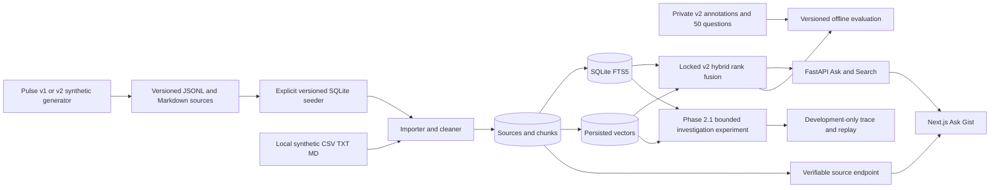
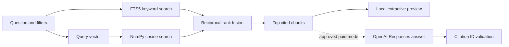
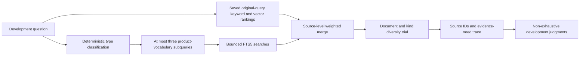
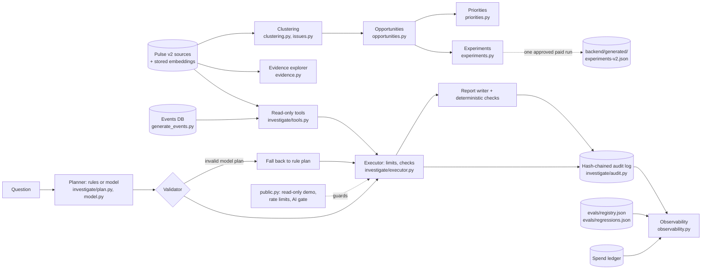

# Gist architecture

## Components and responsibilities

- `backend/scripts/generate_data.py` creates deterministic fictional Pulse source data with a fixed seed.
- `backend/scripts/generate_v2.py` creates a separate scenario-based v2 corpus. `backend/scripts/audit_v2.py` checks repetition, distributions, and timelines. The private source annotations and question ground truth stay under `evals/v2/` and never enter search.
- `backend/scripts/seed.py` selects v1 or v2, refuses implicit database replacement, and builds the no-key index in a version-specific SQLite file. `backend/scripts/rag.py` imports additional synthetic files or, after paid opt-in, persists OpenAI vectors.
- `backend/app/database.py` owns the schema, indexes, source metadata, embeddings, and API usage ledger.
- `backend/app/services.py` owns parameterized SQL and derived statistics.
- `backend/app/rag/ingest.py` cleans and chunks text, preserves source metadata, and computes deterministic local demo vectors.
- `backend/app/rag/retrieval.py` applies filters, runs FTS5 and NumPy cosine search, then combines ranks.
- `backend/app/rag/phase21.py` is an experimental, bounded investigation retriever. It classifies questions, uses at most three local FTS subqueries by default, merges source-level candidates, and records which subquery surfaced each source. It does not replace the locked v2 retrieval path or enter generated answers yet.
- `backend/scripts/evaluate_phase21.py` replays saved original-query development candidate rankings and runs new subqueries locally. It cannot load the frozen v2 held-out set. Results live in `evals/phase21/` and are explicitly not a fresh final evaluation.
- `backend/app/rag/service.py` handles insufficient evidence and checks generated citation IDs.
- `backend/app/rag/provider.py` contains guarded OpenAI calls and records reported tokens, latency, and estimated cost.
- `backend/app/main.py` owns HTTP routing and structured validation errors. `frontend/lib/api.ts` owns typed HTTP access.

## Phase 1 data flow

The generator writes JSONL and Markdown. The seeder loads them into SQLite. A page requests `/api/stats` or `/api/records`; FastAPI validates parameters, the service queries SQLite, and Pydantic shapes the response. The frontend renders only values received from the API. AI calls are absent.

The active dataset is selected by `GIST_DATASET_VERSION` (`v1` by default). v2 uses `backend/gist-v2.sqlite3` unless a matching `GIST_DB_PATH` is explicitly set. Each seeded database stores a source-file SHA-256 fingerprint. The API refuses a version mismatch or a changed source corpus until it is explicitly reindexed; replacing an index deletes its old chunks and embeddings. Older unversioned v1 databases remain readable as legacy v1.

## Phase 2 RAG query flow

The UI sends a question and optional filters to `POST /api/ask`. Demo mode returns retrieved sources or an insufficient-evidence state without generating an answer or making API calls. The guarded OpenAI mode reuses a query embedding cached by exact question, model, dataset version, and source fingerprint when available; a cache miss still requires paid-call approval and a shared-ledger reservation. It combines semantic and keyword ranks, then sends only retrieved snippets to the Responses API. `GET /api/sources/{id}` returns the indexed original source text, and `GET /api/usage` reads the local ledger. Imported source text is evidence, never an instruction. Citation validation checks IDs, but cannot prove that every generated claim is supported. The default demo vectors are lexical hashes. Pulse v2's learned vectors remain stored separately by model and dataset database.

## Phase 2.1 investigation experiment

The experimental reranker preserves source metadata and IDs and adds no model calls for subqueries. A trace says which query found a source; it does **not** prove that the source supports that need. Current measurements replay the saved top-20 original-query rankings, so they do not establish live end-to-end quality. The separate draft benchmark `evals/phase21/benchmark-v2-draft.json` uses the frozen Pulse v2 corpus and has held-out questions excluded from experiment code; its provisional labels require independent human review before a new final evaluation.

## Phases 3–5: product intelligence, investigations and evaluation

- **Phase 3** turns feedback into issues → opportunities → priorities → experiments. Everything is deterministic except the experiment drafts, which were generated once, checked, and are served from a file. The API never makes a paid call to show them.
- **Phase 4** adds a synthetic product-events database and bounded investigations. A plan (from rules, or from a model that must pass the same validator) runs up to 6 read-only tools under timeouts. An optional model report is checked for citations, numbers and certainty language. Every run is appended to a hash-chained audit log.
- **Phase 4.5** reads benchmark values from versioned result files through `evals/registry.json`, and runtime cost and reliability from the ledger and the audit log.
- **Phase 5** adds public mode (`backend/app/public.py`): owner-only writes are blocked, every route is rate-limited, and paid AI requires an access code, per-IP limits, one request at a time and a daily cap. Security headers are set in `frontend/next.config.mjs`.
