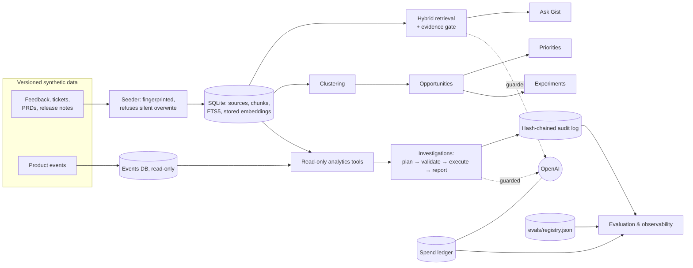
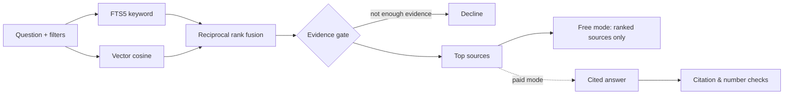

# Gist architecture

Gist has two independent apps:
- `frontend/`: Next.js App Router, TypeScript and Tailwind.
- `backend/`: FastAPI, Pydantic, SQLite (FTS5) and NumPy.

They talk only over HTTP through `frontend/lib/api.ts`, and the frontend renders only numbers returned by the API. All data is synthetic ("Pulse", a fictional SaaS product).

## System overview

## Data and indexing

- **Versioned datasets.** `GIST_DATASET_VERSION` (`v1` or `v2`) selects the corpus and the database. Each seeded database stores a SHA-256 fingerprint of its source files. The API refuses to serve a version mismatch or changed sources until the data is explicitly reseeded with `--replace`.
- **Indexing** (`backend/app/rag/ingest.py`, `backend/app/database.py`): text is cleaned and chunked with its source metadata kept, then indexed in FTS5. Vectors are either free, deterministic lexical vectors or stored OpenAI `text-embedding-3-small` embeddings, which are paid for once and reused.
- **Product events** (`backend/scripts/generate_events.py`): a deterministic generator for 800 accounts and about 155k events, with known causes planted for evaluation. The answer key stays in `evals/` and is never indexed.

## Ask Gist (RAG)

- **Retrieval** (`rag/retrieval.py`): segment, area and date filters; FTS5 and NumPy cosine search combined with reciprocal rank fusion. The configuration is locked by `evals/v2/retrieval-lock.json`.
- **Answers** (`rag/service.py`, `rag/evidence.py`): an evidence gate declines unanswerable questions, and answers can be marked partial. Cited IDs must have been sent to the model, and numbers must appear in the cited sources.
- **Paid calls** (`rag/provider.py`, `rag/budget.py`) go through one guarded provider with output caps and per-call cost recording. A shared spend ledger reserves cost before each call, and an "uncertain" state blocks further spend until reconciled.

## Product intelligence

- **Clustering** (`clustering.py`, `issues.py`): average-linkage sub-themes with looser parent themes, explained by top terms and representative quotes. Vague groups are flagged for triage.
- **Opportunities** (`opportunities.py`): one evidence card per sub-theme, with linked tickets and documents (similarity thresholds chosen on a development half), a severity proxy, a trend, an evidence checklist, assumptions and unknowns.
- **Priorities** (`priorities.py`): a weighted, transparent evidence score. Strategic relevance and effort are optional owner estimates, labelled as estimates.
- **Experiments** (`experiments.py`): AI-drafted experiment suggestions, generated once, checked deterministically and served from `backend/generated/`. They're labelled "not validated", and showing them never makes a paid call.
- **Evidence explorer** (`evidence.py`): search across every source, showing where each one is used.

## Investigations

- **Planner** (`investigate/plan.py`, `investigate/model.py`): a rule-based planner ($0), or a model planner whose plan must pass the same validator. The validator allows at most 6 steps, only read-only tools with typed arguments, and requires the baseline to come before the target.
- **Executor** (`investigate/executor.py`): per-step and total timeouts, capped result sizes, no retries, and at most 2 model calls per investigation. Output checks flag small samples, tracking gaps and mostly-mix changes.
- **Tools** (`investigate/tools.py`): a fixed metric catalogue over a read-only connection, a mix-vs-rate decomposition, a data-quality scan, release and document lookup, and feedback search.
- **Report** (optional, paid): the report is checked before it's shown. Every claim must cite a step that ran, numbers must appear in the tool output, and certainty language is rejected. A failed report is withheld, with its raw text kept for audit.
- **Audit** (`investigate/audit.py`): an append-only log in which each entry's hash covers the previous one, so any edit is detectable.

## Evaluation and observability

`observability.py` reads every benchmark metric from its versioned result file, through the locations listed in `evals/registry.json`, and shows each file's SHA-256 hash. Runtime cost, tokens, latency and failures come from read-only queries over the spend ledger and the audit log. `evals/regressions.json` maps past failures to the tests that guard them. See [how results are judged](../evals/README.md).

## Public mode

`backend/app/public.py` is enabled by `GIST_PUBLIC_MODE=true`:
- shared state is read-only, and feedback is ratings only;
- every route has a per-IP rate limit and a request-size cap;
- paid AI requires an access code, per-IP limits, one request at a time and a daily cap checked before spending.

`frontend/next.config.mjs` sets the CSP and security headers. The deployed API starts from a verified read-only data snapshot (`deploy/`).
