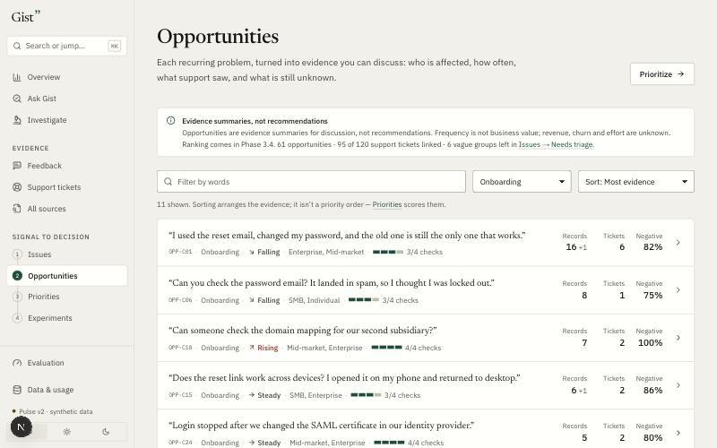
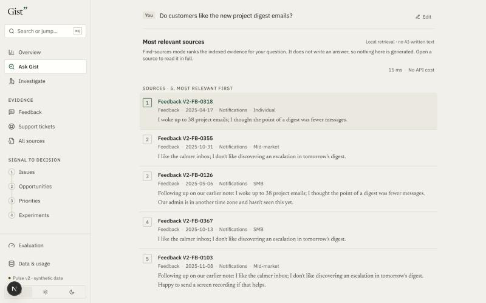
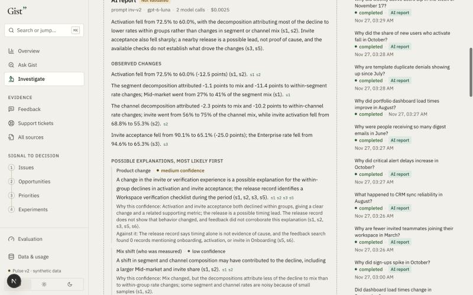
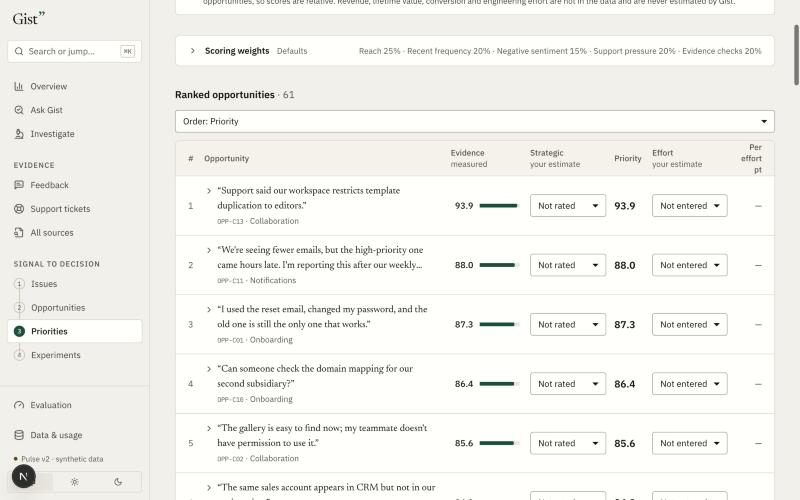
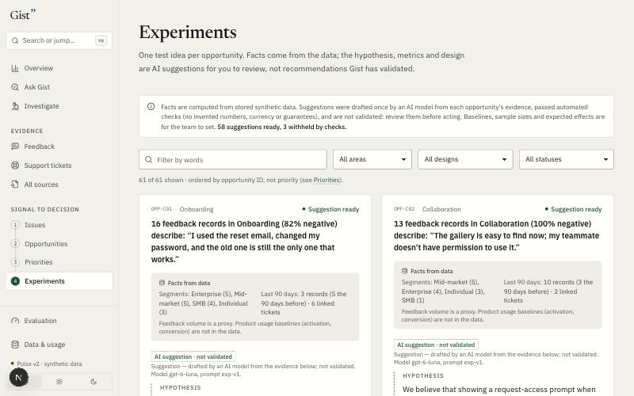

# Demo scenarios

Five walkthroughs from the roadmap (J3). Each one was run in the app on Pulse v2 (synthetic) on 2026-11-27, and each shows what Gist knows, how it knows it, and what it cannot tell you. Start the app with `GIST_DATASET_VERSION=v2 npm run dev`, or use the public demo.

Scenarios C and E use **stored AI runs**, so they cost nothing to view. Running new AI requests needs paid mode or a public-demo access code.

---

## A. Find the biggest onboarding complaints

**Where:** Opportunities → Area: *Onboarding* (sorted by most evidence).

**What you see**
- 11 onboarding opportunities. The largest is a password-reset problem ("the old one is still the only one that works"): **16 records** (+1 that mention it alongside another problem), **6 linked support tickets**, **82% negative**.
- Each row has a trend (falling, rising or steady), the segments affected, and an **evidence checklist** (3/4 or 4/4 checks). It is not a "confidence score".

**Evidence and limits shown in the app**
- The banner says opportunities are *evidence summaries, not recommendations*: frequency is not business value, and revenue, churn and effort are unknown.
- Clicking a card opens the quotes, every supporting record and the linked tickets. Each record ID opens its entry in the Evidence explorer.
- Sorting arranges the evidence; it is not a priority order. Priorities does that, transparently.

---

## B. Analyze conflicting customer feedback

**Where:** Ask Gist → "Do customers like the new project digest emails?" → *Find sources* (free, local retrieval).

**What you see**
- The five most relevant sources disagree. Some say *"I woke up to 38 project emails; I thought the point of a digest was fewer messages"* (digest overload, April). Others say *"I like the calmer inbox; I don't like discovering an escalation in tomorrow's digest"* (October–November).
- The second group is a **look-alike problem**. After the September notification change, the inbox got calmer but urgent alerts arrived late. The benchmark answer key treats these as different issues: digest noise vs. alert delay.

**Evidence and limits shown in the app**
- Find-sources mode ranks evidence and writes nothing ("Local retrieval · no AI-written text", "No API cost").
- Every result opens the original text.
- In paid mode Gist writes a cited answer; when the sources only partly cover a question it marks the answer **partial** and says what is missing.
- **Known weakness:** contradictory and multi-source questions were the weakest category in the Phase 2.3 held-out test.

---

## C. Investigate an activation decline

**Where:** Investigate. Open the stored AI run "Why did activation drop in February?", or run the free rules planner on "Why did onboarding activation drop in October?".

**What you see (February, AI plan and report, $0.0025)**
- **Observed:** activation fell from 72.5% to 60.0% (−12.5 points). The split shows −11.4 points from rates *within* segments and only −1.1 points from segment mix. The AI planner also checked a feeding metric: **invite acceptance fell from 90.1% to 65.1%**.
- **Top explanation:** a change in the invite/verification experience (product change, *medium* confidence). Its timing matches release 01, the workspace verification checklist. That is the planted cause in the answer key.
- **Evidence against it** is listed too: the release note says timing alone is not proof, and no matching onboarding feedback was found.

**October (rules planner, $0)**
- Activation fell 6.8 points, but **−9.1 points came from mix** (a paid campaign went from 0% to 38% of sign-ups) and +2.3 from rates. Gist flags it as *mostly mix*: a change in **who signed up, not a broken product**. That is the decoy.

**Evidence and limits shown in the app**
- Every statement cites the tool step that produced it (s1, s2…). Measured findings are separate from the dashed **"AI report · Not validated"** box.
- The report is checked before it is shown: citations must exist, numbers must appear in the tool results, and certainty language is rejected.
- The plan, trace, timings and result hashes are in a hash-chained audit log.

---

## D. Identify and prioritize product opportunities

**Where:** Priorities.

**What you see**
- 61 opportunities, ranked by an **evidence score** (0–100) built from five measured parts:

  | Part | Weight |
  |---|---|
  | Reach | 25% |
  | Recent frequency | 20% |
  | Negative sentiment | 15% |
  | Support pressure | 20% |
  | Evidence checks | 20% |

- "Strategic relevance" and "Effort" start as **not rated / not entered**. They are your estimates, labelled as such, and only count once entered.
- Expanding a row shows each part's raw value, score, weight and contribution, and the arithmetic.

**Evidence and limits shown in the app**
- Count-based parts are ranks among these opportunities, so scores are relative.
- Revenue, lifetime value, conversion and effort are never estimated by Gist.
- Changing any one weight by ±50% keeps 9.6 of the top 10 on average. The score still correlates 0.85 with reach, so volume drives much of it.

---

## E. Generate a product experiment

**Where:** Experiments.

**What you see**
- One experiment card per opportunity. The card's heading and **"Facts from data"** come from the data: records, % negative, segments, the 90-day baseline and linked tickets. The **AI suggestion** sits in a separate, labelled box: hypothesis, intervention, audience, primary metric, guardrails, design, risks and assumptions to validate.
- 58 of 61 drafts passed automated checks (no invented numbers, currency or guarantees); 3 are withheld, with the reason shown.

**Evidence and limits shown in the app**
- Every suggestion is labelled "Suggestion — not validated".
- Baselines, sample sizes and expected effects are left to the team; Gist never invents them.
- The owner reviewed 10 random cards: **5 useful, 5 need work, 0 wrong**. Common weaknesses were a primary metric that measured the wrong thing, and proposing a fix before diagnosing the problem.
